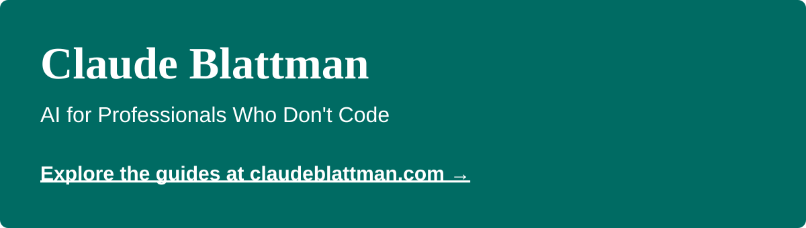

[](https://claudeblattman.com)

Practical AI guides for professionals who don't code. Visit **[claudeblattman.com](https://claudeblattman.com)** for the guides and walkthroughs. This repository holds the starter kit, skill library and website source. It's free and open source.

## Who It's For

- Academics and researchers managing multiple projects
- Professionals buried in email, meetings, and coordination
- Anyone who wants to move beyond casual chatbot use

No coding background required. Ask your AI to walk you through the guides and help you get started.

## Starter Kit

The starter kit gives Claude Code and Codex seven skills for developing work with a council, getting a fresh review, improving prompts, connecting other agents and saving a handoff for your next session.

Start with the **[installation walkthrough](https://claudeblattman.com/starter-kit/occasional/#1-install-the-starter-kit-or-use-plain-language)**. For prerequisites, connections to other AIs and updates, see the [package guide](starter-kit-source/PACKAGE-README.md).

**Validation status:** The package is marked 0.3.1; its documentation lists live acceptance testing as pending. See the package guide for current validation limits.

## More Skills

Browse the **[skill library](skills/README.md)** for standalone skills and reference workflows from my setup. Each guide explains what is ready to install and what needs adapting.

**Featured: [Aniket Me](skills/aniket-me/README.md)** applies Aniket Panjwani's public advice to help improve how you work with AI. Give your agent the linked guide to install or update it, then try it on your work.

## Repo Structure

```
claudeblattman/
├── docs/                       # Website source (MkDocs Material)
├── starter-kit-source/         # Shared source for both starter-kit plugins
├── plugins/starter-kit-claude/  # Generated Claude plugin
├── plugins/starter-kit-codex/   # Generated Codex plugin
├── skills/                     # Standalone skills and reference workflows
├── agents/                     # Downloadable agent files
├── templates/                  # Starter templates (CLAUDE.md, goals.yaml)
├── mkdocs.yml                  # Site configuration
├── CONTRIBUTING.md             # Maintenance guide
└── LICENSE                     # MIT
```

## Contributing

See [CONTRIBUTING.md](CONTRIBUTING.md) for how to edit content, add skills and maintain the site, and [Editing drafts](DRAFT_EDITING.md) for sharing previews. The [starter-kit release notes](starter-kit-source/RELEASE-NOTES.md) describe package changes and validation status.

## License

MIT — use anything here however you want.

---

Built by [Chris Blattman](https://chrisblattman.com). The name is a joke. The tools are real.
