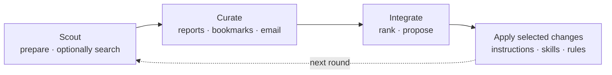

# Scout and curate new AI tips

Tips arrive every day — X especially, but also blogs, newsletters, Slack, the occasional email from a friend who just discovered something. It's a firehose. The temptation is to drink from it. The result is churn.

Six questions I keep running into:

- Which tips are worth adopting?
- Where do I store them so they're not lost?
- How do I remember the ones I already filed?
- How do I prioritize what to actually integrate?
- How do I get a tip into my workflow, not just a notes file?
- How do I avoid wrecking a working setup with a bad addition?

This is the system I built for myself. It might work for you. You may want to adapt it. Either way, here it is.

I use three skills to collect ideas, decide which are useful, and put selected improvements to work. Run them when you have something worth investigating; they do not run on a schedule unless you arrange that separately.

1. **Scout** — prepare a search from gaps in your existing tips log. Ask it to consult Grok if you want it to run the search too.
2. **Curate** — collect tips from saved reports, X bookmarks or email. Compare them with what you already saved, assess their value, and file selected findings in one shared log.
3. **Integrate** — turn the useful ideas into concrete changes or investigations. For larger batches, five independent critics help rank them.
4. **Apply** — review the proposed changes and have the agent apply the ones you choose. Keep the results for the next round.



`/tips-curate` offers to invoke `/tips-integrate` when more than 15 High tips await a decision. You can also run integration on a smaller batch whenever you want.

---

## A council, not a checklist

Stage 3 is where this loop differs from a typical "save tips and try them later" practice. One Claude rating its own tips is peer-reviewing your own paper. The model anchors on the framing of the tip and produces convergent praise. I tried that for a few months and ended up with a config full of plausible-sounding additions that didn't compound and weren't worth their maintenance.

The fix is structural disagreement. Five personas in parallel, each told to score from one specific lens and not balance — Maintenance Tax notices that a tip depends on a single-maintainer repo, Catalog Conflict notices it duplicates an existing rule, First-Run notices that the "obvious" first step actually requires three design decisions. The composite scores them; the user approves. The council helps rank the options; you decide which changes to make.

The shared starter kit provides the general [Council and review workflows](../starter-kit/occasional.md). This tips workflow uses five specialist critics whose instructions are [bundled with Tips Integrate](https://github.com/chrisblattman/claudeblattman/tree/main/skills/tips-integrate/references). It skips that panel for batches of five or fewer actionable ideas.

---

## Meet the five critics

| Critic | What it asks |
|---|---|
| **Catalog Conflict** | Does this fight something I already do? |
| **Maintenance Tax** | What will this cost me in six months? |
| **Compounder** | Does this make other skills better, or sit alone? |
| **First-Run** | Is the 30-minute first step concrete? |
| **Skeptic** | Real practitioner use, or engagement farming? |

Each persona scores every candidate tip 1–5 with a single-sentence rationale and a concrete blocking concern or `BLOCKING: none`. Five personas × N tips = a stack of structured opinions, not a vote.

!!! example "An illustrative critic response"
    ```
    TIP: 2026-04-12::Use XML tags around few-shot examples
    PERSONA: Maintenance Tax
    SCORE: 4
    RATIONALE: XML tag conventions are documented Anthropic guidance
      and survive model upgrades; no third-party dependency to rot.
    BLOCKING: none
    ```

??? example "How the ranking works"
    The score is the mean of the returned critic scores, minus 0.1 for each blocker. The agent shows missing perspectives and disagreements alongside the ranking. At least three of the five critics must return; otherwise it stops and retains the batch for a later attempt.

    The top seven become concrete proposals, starting with the first three. Remaining candidates stay visible. A score does not authorize an edit: the agent shows the proposed changes and applies those you approve, or those already covered by your request.

---

<a id="example-from-email-to-proposal"></a>
## A tip's journey, end to end

Here is an illustrative tip, walked through the full loop:

=== "1. Discover"
    A blog post crosses my feed. I forward it to myself with `@toself` in the subject — works from my phone, my laptop, anywhere. Gmail tags it automatically.

    ```
    To: me
    Subject: @toself xml tags in skills
    Body: https://example.com/post — author shows that
    wrapping few-shot examples in <example>...</example>
    cuts misparses by ~30%.
    ```

=== "2. Curate"
    When I run it with the email connection configured, `/tips-curate` reads unread `@ToSelf` email, classifies each, fetches link content where it can, and rates the result High / Medium / Low. The approved entry lands in the [tips log](#the-tips-log):

    ```markdown
    ## 2026-04-12

    ### Use XML tags around few-shot examples [skill-design] [prompting] [high]
    - **Source:** [author] (Apr 11, 2026)
    - **Insight:** Wrap few-shot examples in <example> tags inside
      skill prompts — improves Claude's parsing of multi-example
      sections vs. plain text.
    - **Action:** Add an XML-tag convention to CLAUDE.md skill
      authoring rules; retrofit two highest-traffic skills.
    - **URL:** https://example.com/post
    ```

=== "3. Integrate"
    Two weeks later the high-tip backlog crosses 15. `/tips-curate` offers to invoke `/tips-integrate`. Five personas dispatch in parallel against the batch. The composite for this tip:

    ```
    Catalog Conflict:  4   (no existing rule on tag conventions)
    Maintenance Tax:   4   (Anthropic guidance, no rot)
    Compounder:        5   (lifts every skill that uses examples)
    First-Run:         5   (one CLAUDE.md line; clear retrofit list)
    Skeptic:           3   (one author, but evidence is concrete)

    composite = 4.2 − 0 = 4.2  →  rank #2  →  first proposals to review
    ```

=== "4. Applied"
    The agent proposes a direct change. I see the diff:

    ```diff
     ## Skill authoring rules

    +- Wrap multi-example sections in <example>...</example> tags.
    +  Improves Claude's parsing reliability vs. plain prose.
     - Skills under 300 lines unless layered structure required.
    ```

    I ask it to apply the change. It updates the file, checks the result, and records the completed integration so the same tip is not proposed again.

Investigation tasks (Type B — tips that need design work before any file change) take a different exit: instead of a direct edit, the council writes a one-line entry to your [learning catalog's INBOX](#the-learning-catalog) for triage at your own pace.

---

## What it has actually changed

A sample of recent council-approved edits from the log:

| Tip | Resulting change |
|---|---|
| Wrap few-shot examples in `<example>` tags | New rule line in CLAUDE.md skill-authoring section |
| Use action verbs over "be thorough" in depth-injection | Updated `prompt-preferences.md` depth tier table |
| Pre-flight glob for persona files before council dispatch | New rule in `agent-dispatch.md` |
| Cap context-management thresholds in absolute tokens (4.7 / 1M) | Rewrote `context-management.md` warning thresholds |

Most weeks produce one or two direct edits. Most of the council's output is *investigation tasks* — tips that need a design decision before any file change — which land in the learning catalog INBOX rather than the config.

!!! tip "First runs are mostly investigations, not edits."
    The council often defers tips into research tasks rather than rule changes. That's the system working — it's protecting your config from churn. Direct-edit volume rises as your setup grows and the skill has more concrete files to point at.

---

<a id="the-four-steps"></a>
## The three skills

### `/tips-scout` — prepare a useful search

Reads the last 14 days of the shared tips log and any configured active tasks, then prepares a search prompt that emphasizes gaps and questions relevant to your work. It saves that prompt. Invoking the skill alone does not call another AI.

To ask Grok to run it too:

```text
/tips-scout Prepare this week's search and ask Grok to run it. Save the response so I can curate the findings.
```

That uses the starter kit's `/ask-agents` connection to the official Grok subscription tool. It is a source-search consultation, not a claim to invoke a separate DeepSearch mode. If the connection is missing, the agent saves the prompt and explains what needs connecting. It does not silently switch providers or ask you to paste into a browser.

[Tips Scout folder →](https://github.com/chrisblattman/claudeblattman/tree/main/skills/tips-scout)

### `/tips-curate` — collect, assess and file

Handles bookmarks, email tips and saved research reports in one workflow. The former `/tips-bookmarks` skill is now part of this one. You can use any of these sources; they do not all need to be connected.

```text
/tips-curate Read the scout report we just saved and suggest what is worth keeping.
```

Naming a report processes that report alone. A general `/tips-curate` request checks configured bookmarks and tips email. It compares URLs and underlying claims with the shared log, preserves source links, and proposes High, Medium or Low ratings. It also notes whether an idea applies to Claude, Codex, both, or belongs on a watch list.

After you select what to keep, it saves the entries and verifies them before marking source items processed. Failed or deferred items remain available. `/tips-curate dryrun` shows proposed results without saving files or changing email/bookmark state.

[Tips Curate folder →](https://github.com/chrisblattman/claudeblattman/tree/main/skills/tips-curate)

### `/tips-integrate` — turn ideas into changes

Reads the tips and configured instructions, skills and other targets. For larger batches, five fresh critics rank up to 15 candidates. For five or fewer, it goes straight to proposals. It shows concrete edits for ideas that can be applied now and queues investigations for those that need more work.

```text
/tips-integrate Show me which saved tips would be most useful for my setup and what you would change.
```

The agent applies selected changes, checks them and records what happened. An investigation queued for later is not counted as an implemented improvement. Deferred and overflow items remain pending rather than disappearing after a run.

[Tips Integrate folder →](https://github.com/chrisblattman/claudeblattman/tree/main/skills/tips-integrate)

---

## Setup

Ask your agent to install the whole skill folders, including their supporting references:

```text
Help me set up tips-scout, tips-curate and tips-integrate from the skills folder at github.com/chrisblattman/claudeblattman. Keep my existing customizations. Use one shared tips log across my AI apps, and walk me through connecting the sources I want to use.
```

These are public adaptations of my workflow. They include the critic instructions and a starting search prompt, but your accounts, log and target files need configuring. Live connections depend on your app and setup.

The default tips folder is `~/.claude-assistant/tips/`; reuse an existing location if you have one. Keep logs and state outside the installed skill folders so an update does not replace them. Start with `/tips-curate dryrun`, then save a small batch and try `/tips-integrate dryrun` before applying changes.

### Optional email collection

If you want to forward tips to yourself, connect your email and create a Gmail label called `@ToSelf`. An optional filter can apply that label to messages whose subject contains `@toself`. The agent can help set this up. Saved reports work without an email connection; bookmark collection needs a connection that can read your saved posts.

---

## When to run

| Skill | When it is useful |
|-------|-------------------|
| `/tips-scout` | You want to look for ideas relevant to your current work. |
| `/tips-curate` | You have new bookmarks, tips email or a research report to sort through. |
| `/tips-integrate` | You are ready to decide which ideas to put into practice. |

There is no minimum backlog or fixed schedule. If you use both Claude and Codex, keep one shared log; the route attached to each idea helps the agent choose the right place to apply it.

---

## The tips log

The curate step writes approved tips to a dated, tagged markdown file that grows over time. Each entry records what you found, where it came from, and what to do about it. The [worked journey above](#a-tips-journey-end-to-end) illustrates the format — date, tags like `[prompting]` or `[skill-design]`, source link, insight, and a concrete next action.

After six months mine had 85+ entries. You don't need to remember what you read last month — search the log by keyword or tag, or point Claude at it and ask "what do I have on agent patterns?" The log becomes institutional memory that survives across sessions.

Browse a [snapshot of my actual tips log](downloads/collected-tips-log.md) to see what this looks like at scale.

---

## The learning catalog

The tips log captures discoveries. The learning catalog captures *decisions* — what's worth doing, what you've tried, what you've dismissed.

When `/tips-integrate` flags a tip as needing research before action (Type B), it lands in the catalog's **INBOX** section. You review periodically and promote each item to a tier:

| Tier | Meaning |
|------|---------|
| **HIGH** | Clear payoff, do soon |
| **MEDIUM** | Worth evaluating, not urgent |
| **LOW** | Not worth pursuing now; kept for reference |
| **DONE** | Implemented and working |
| **REJECTED** | Assessed and dismissed; won't resurface |

Items always enter via INBOX — the skill doesn't make priority calls on your behalf.

Each HIGH and MEDIUM entry carries plain-English context: *what it is*, *why it matters for you*, and *next step*. The format is designed for future-you who's forgotten the original tip. A DONE entry looks like:

| Item | Was | Completed |
|------|-----|-----------|
| arjunkmrm/recall | Cross-session search — `/recall` searches 1,918 past conversations by keyword | Mar 3, 2026 |

DONE and REJECTED entries are never deleted — they prevent you from re-evaluating the same thing six months later.

---

## Browse real examples

The kinds of workflows and resources the pipeline is designed to capture and evaluate. Worth browsing to see what's out there:

- **[Boris Tane: How I Use Claude Code](https://boristane.com/blog/how-i-use-claude-code/)** — The research-annotate-implement workflow. One of the highest-rated tips in my log.
- **[Anthropic's Official Skills Library](https://github.com/anthropics/skills)** — Anthropic's own example skills, including a document plugin for PDFs and spreadsheets.
- **[Awesome Claude Skills](https://github.com/travisvn/awesome-claude-skills)** — Community-curated list of skills, patterns, and tools. Good scouting territory.
- **[Anthropic Skills Cookbooks](https://github.com/anthropics/claude-cookbooks/blob/main/skills/README.md)** — Tutorial notebooks for building custom skills from scratch.

---

## Customization

**`/tips-curate`:** Tips log location, Gmail label name, batch size, quality thresholds — all configurable by editing the skill file directly.

**`/tips-integrate`:** Source selection, target files, and investigation destination. Keep state and pending decisions when changing the configuration.

---

!!! tip "The other input channel: your own corrections"
    You can also improve your setup from what happens during work. The [continuous improvement guide](../how-i-improve-the-work.md) explains how to capture corrections and use them to revise your writing guidance.

---

## See also

- **[Collected Tips & Research Log](downloads/collected-tips-log.md)** — A snapshot of my own tips log. Searchable by keyword, tag, or date.
- **[Council and review](../starter-kit/occasional.md)** — the maintained starter-kit workflows for developing work and challenging it with fresh reviewers.
- **[The bundled tips critics](https://github.com/chrisblattman/claudeblattman/blob/main/skills/tips-integrate/references/proposal-critics.md)** — full persona definitions.
- **[Council review](../starter-kit/occasional.md)** — Pairs well with the pipeline: curate ideas, then review plans before implementing.
- **[Skill Design Patterns](downloads/skill-patterns.md)** — How production skills are structured, if you want to build your own.
- **[Building skills](../build-your-own/building-skills.md)** — Patterns the council looks for when scoring "Compounder".
