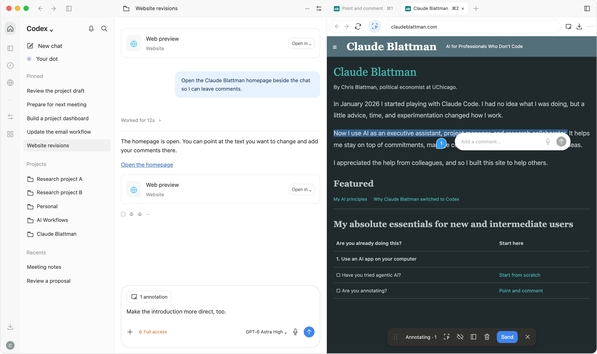
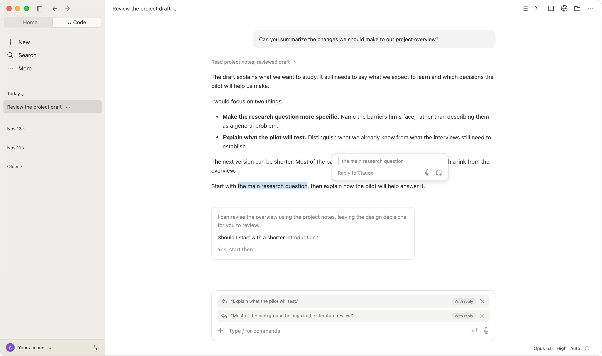
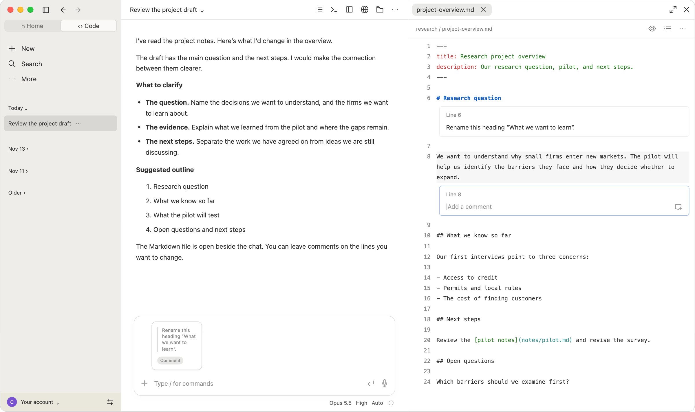
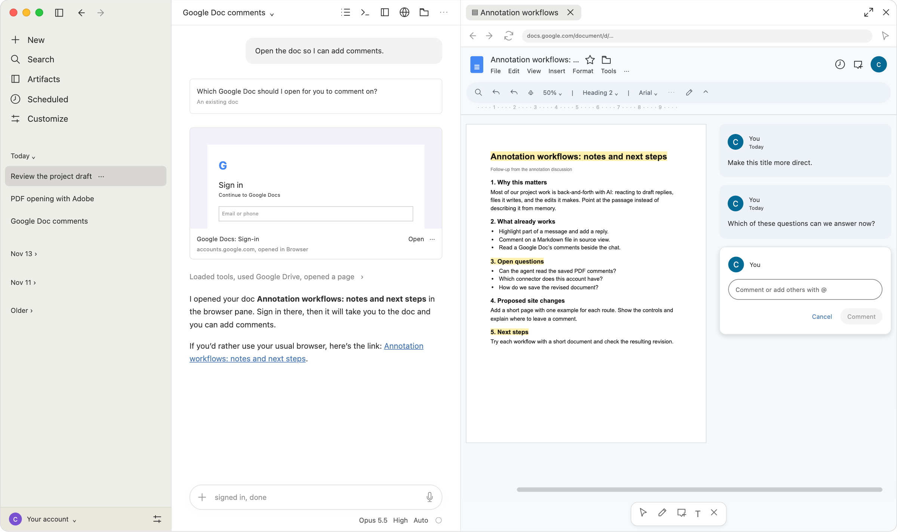
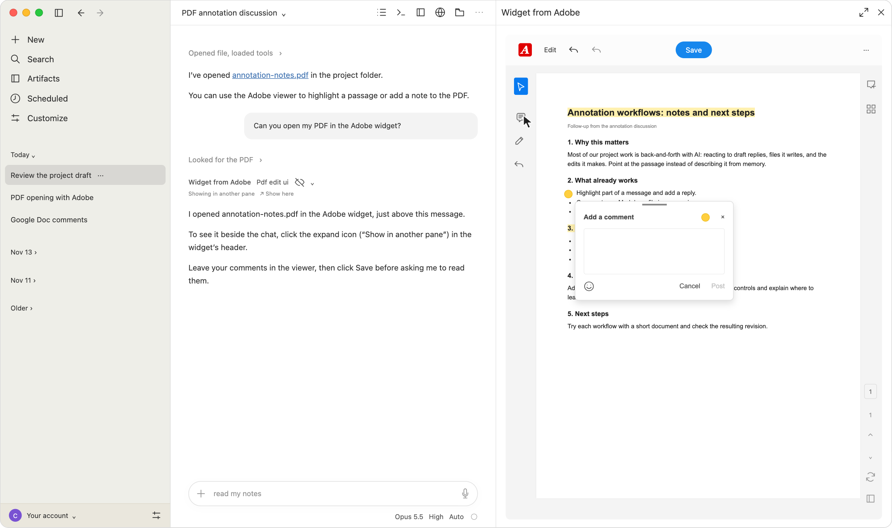

<!-- DRAFT (drafts/annotation-20261116). Items marked VERIFY are from Chris's
     Nov 12 description or the Nov 6 demo and have not been retested. Check each
     in the app before publishing; cut anything that doesn't hold up.
     Google Docs and Adobe sections come from Shay's Nov 16 tests
     (ANNOTATION_TESTS_GOOGLE_DOCS / ANNOTATION_TESTS_ADOBE in the relaunch folder). -->

# Annotate the documents to point at specific changes

**Stop describing what you want changed. Point at it.** Most of working with an agent is back-and-forth on what it produced: a reply, a plan, a draft, a webpage, a PDF. Annotating lets you mark the exact spot—“cut this,” “I don't follow,” “these two belong together”—instead of describing with words which paragraph you mean.

Typically, I'll leave a bunch of comments in annotation mode, then add a big-picture comment to the message box. Sending those together lets the agent address them all at once and make changes more holistically.

New to the desktop apps? [The desktop-app guide](from-terminal.md) introduces working with the conversation and your draft in the same window.

!!! note "Current as of November 2026"
    These features are changing quickly, and Codex and Claude handle them differently. If something here doesn't match what you see, ask your agent how it works in your version.

    The interface illustrations below are reconstructed from screenshots supplied on November 16, 2026.

## 1. Built-in Codex

Codex has the most complete annotation workflow I've used. It's one reason I prefer it right now.

The basic process is the same whether you're looking at a webpage, a Markdown file, a Word document, or a PDF: open it beside the chat, point at the part you want changed, and leave a comment.

<!-- VERIFY (Shay, Nov 6 demo): comments queue below the chat box until sent. Confirm exact wording of the controls. -->
Your comments collect with your next message until you send them. Add a general note alongside the specific ones if you like: “The whole thing is too formal.” Then send them together so the agent can work through the changes at once.

**Webpages.** In Codex's browser, select **Annotate**, click something or draw a rectangle around it, and leave a comment. It's how we're editing this site.



<!-- VERIFY (Chris, Nov 12): comments directly on the formatted Markdown preview. He thought this was new. -->
**Markdown files.** Open the file in the preview beside the chat, click a passage, and leave a comment. You don't need to switch to the raw text.

<!-- VERIFY (Chris, Nov 12): same annotation on Word and PDF previews. -->
**Word documents and PDFs.** The same commenting works in Codex's document previews.

**Replies.** You can comment on Codex's in-session replies, too. Select the response you don't like or want more explanation on, then ask.

<!-- SCREENSHOT: one tested Codex example — a comment on a draft, the queued comments, and the agent's revision. Date the screenshots. -->

## 2. Built-in Claude

Claude's built-in tools cover the conversation and plans. They don't yet cover webpage, PDF or Word previews; for these types of documents, you'll need another route.

**Replies.** You can add comments to the in-session replies Claude gives you. Highlight the passage, choose **Reply**, type your comment and press Enter. It's added to your next message without sending it, so you can stack several and send them together.



**Plans.** When Claude writes a plan and opens it in the side pane, you can comment on it the same way.

<!-- View source control confirmed in Shay's Nov 16 screenshot. VERIFY: "+" beside a source line still needs a direct check. -->
**Markdown files.** To comment on Markdown files in Claude, you need to switch to **source view**. Open any Markdown (`.md`) file in the file pane, including one you wrote yourself. Click the **<code>&lt;/&gt;</code> button in the top-right corner**, labeled **View source**. This shows the text with line numbers. Click **+** beside a line to add a comment. In Codex, you can comment directly in the formatted view.



**Code changes.** If the agent edits a website or other files, you can comment on changed lines in the Git changes view.

For documents you can't comment on directly in Claude, the next two sections show how to bring Google Docs or Adobe into the app. You leave comments in the document itself, then ask Claude to read them. Google Docs is the simpler route; PDFs take a few extra steps.

## 3. Google Docs in Claude

**This is the document route that works best in Claude right now.** Claude writes the draft as a Google Doc, you comment on it the usual way (the same way you would in a web browser), and Claude reads your comments back, each attached to its passage. These connectors may be turned off if you're using an enterprise account.



1. **Turn on your Google Drive and Google Docs connectors** in **Settings → Connectors**. The Docs connector lets Claude read comments and edit the document; Drive lets it create new Google Docs for you. If a connector you just added doesn't show up, start a new session.
2. Ask Claude to write the draft as a Google Doc. If you only have the Docs connector, make a blank doc at [docs.new](https://docs.new) and give Claude the link.
3. Ask it to open the doc in the side panel. The first time, sign in to Google there, just as you would in a new browser.
4. Select text and click the comment icon (or press Cmd+Option+M). Comments save as soon as you post them.
5. Send Claude your overall feedback along with a request to work through the comments. For example:

<!-- VERIFY: reading comments was tested; revising the document and resolving comments still need an end-to-end check. -->

```text
Address my comments in the Google Doc. Once you've addressed them, you can resolve them.

In general, the whole document is too technical and should be written in simpler English.
```

## 4. PDFs in Claude: the Adobe connector

**This works, but is messy.** You can open a PDF in Adobe's viewer widget beside the chat and comment on it. However, uploading the file and getting the comments back through the steps below leaves three copies of the PDF in Adobe's storage.

<div class="council-loop council-overview pdf-roundtrip">
<div class="council-horizontal" tabindex="0" role="region" aria-label="PDF comment round trip; scroll horizontally on small screens">
<svg xmlns="http://www.w3.org/2000/svg" viewBox="0 0 1000 290" role="img" aria-labelledby="pdf-roundtrip-title pdf-roundtrip-desc">
<title id="pdf-roundtrip-title">From your PDF to Adobe and back</title>
<desc id="pdf-roundtrip-desc">Your local PDF is uploaded to Adobe. Saving comments creates a second cloud copy. Compressing it to get a download link creates a third. Claude downloads the commented file, extracts the saved annotations, and uses them to revise the project source and regenerate the PDF. If only a PDF is available, first agree how to edit it. After checking the revisions, remove the temporary download.</desc>
<defs><marker id="pdf-roundtrip-arrow" markerWidth="7" markerHeight="7" refX="6" refY="3.5" orient="auto"><path d="M1 1 L6 3.5 L1 6" fill="none" class="council-arrowhead" stroke-width="1.1"/></marker></defs>
<rect class="council-edge council-return" x="195" y="25" width="560" height="174" rx="2"/>
<text x="475" y="49">Adobe storage: three copies</text>
<text x="85" y="49">Your computer</text>
<text x="900" y="49">Your computer</text>
<path class="council-edge" d="M160 111 H210" marker-end="url(#pdf-roundtrip-arrow)"/>
<path class="council-edge" d="M360 111 H400" marker-end="url(#pdf-roundtrip-arrow)"/>
<path class="council-edge" d="M550 111 H590" marker-end="url(#pdf-roundtrip-arrow)"/>
<path class="council-edge" d="M740 111 H810" marker-end="url(#pdf-roundtrip-arrow)"/>
<rect class="council-session" x="10" y="79" width="150" height="64" rx="2"/>
<text x="85" y="104">Original PDF</text>
<text class="council-note" x="85" y="125">The file you work on</text>
<rect class="council-command pdf-adobe-copy" x="210" y="79" width="150" height="64" rx="2"/>
<text x="285" y="104">1. Uploaded copy</text>
<text class="council-note" x="285" y="125">Opens in the viewer</text>
<rect class="council-command pdf-adobe-copy" x="400" y="79" width="150" height="64" rx="2"/>
<text x="475" y="104">2. Commented copy</text>
<text class="council-note" x="475" y="125">Created when you save</text>
<rect class="council-command pdf-adobe-copy" x="590" y="79" width="150" height="64" rx="2"/>
<text x="665" y="104">3. Compressed copy</text>
<text class="council-note" x="665" y="125">Gives a download link</text>
<rect class="council-session council-return" x="810" y="79" width="180" height="64" rx="2"/>
<text x="900" y="104">Temporary download</text>
<text class="council-note" x="900" y="125">Claude reads the comments</text>
<path class="council-edge" d="M900 143 V245 H85 V145" marker-end="url(#pdf-roundtrip-arrow)"/>
<text x="500" y="233">Address the comments in the source and regenerate the PDF</text>
<text x="500" y="272">Then delete the temporary download (the Adobe copies remain in the cloud)</text>
</svg>
</div>
</div>

**Sign in or use it as a guest?** You can do either. Signing in makes more sense if you want to return to the PDFs later.

<div class="adobe-account-options" markdown="1">

| How you connect | What's useful | The tradeoff |
|---|---|---|
| **Guest (not signed in)** | Keeps extra PDF copies out of your Adobe cloud storage. | Treat the files as temporary; get your commented PDF back before leaving the session. |
| **Signed in** | Supported work stays available across sessions, and you get access to more tools. | Saved copies take up cloud storage and need occasional cleanup. Free storage is limited to [5 GB](https://helpx.adobe.com/acrobat/web/manage-cloud-storage/manage-adobe-cloud-files/file-size-storage-limitations.html). [EDU accounts aren’t supported](https://helpx.adobe.com/creative-cloud/apps/integration-with-other-apps/adobe-connectors/adobe-for-claude.html). |

</div>

1. **Connect Adobe.** In Claude, open **Settings**, search for **Connectors**, then search for **Adobe**. Click **Connect**. Sign in to Adobe or continue as a guest.
2. **Open your PDF.** Ask Claude to open the file in the Adobe widget. Click **Show in another pane**, the expand icon in the widget's header, to see it in a larger format beside the chat.
3. **Add your comments.** Use the PDF's comment tools, just as you would in Adobe itself.
4. **Click Save at the top.** Wait until it has finished saving before asking Claude to address your comments. Saving creates a new copy with your comments; it doesn't update the uploaded copy.
5. **Have Claude read and address the comments.** Ask it to download the saved copy and extract the comments, including their page numbers and the passages they refer to. Reading the PDF's main text alone misses those notes.
6. **Put the revisions back in your project folder.** If you have the document the PDF came from, have Claude revise that and make a new PDF. If you only have the PDF, ask it how it can make the changes before replacing anything. Once the revised files are saved and checked, it can delete the temporary download. This keeps your project folder tidy; it doesn't remove the copies in Adobe.



**If you do this often, put the steps in a skill.** Then you can use `/adobe` to open the PDF and say “read my notes” when you're done. Ask:

```text
Make me a skill called /adobe. If I already have one, adapt it to this workflow.

When I run it, open the PDF I most recently mentioned or you most recently sent me in the Adobe widget. Or I might call /adobe file/path/here.pdf; in that case, open that file. Remind me to click "Show in another pane" to see it in a larger format.

When I say "read my notes" or "read my comments":
1. Find the copy I saved with comments.
2. Compare its file size with the original, and check that the comments are actually present.
3. Download the version with comments. If Adobe doesn't give you a download link, use the compression step, then check that the downloaded file still contains the comments.
4. Extract the PDF's saved annotations, not just its page text. Read each comment with its page number and the passage it refers to. Address the comments in the editable source document, if we have it, then regenerate the PDF in our project folder. If we only have a PDF, explain how you can edit it and agree the approach with me before replacing the original. Tell me about any comments you couldn't address.
5. Once the revised source and PDF are saved and checked, delete the temporary local download with comments. If we edited only the PDF, check that revised PDF before deleting the download.
```

Alternatively, split this into two skills. `/adobe-in` or `/adobe-annotate` could upload your local PDF to Adobe and open the widget beside your chat. Then `/adobe-out` or `/adobe-revise` could handle steps 1–5 in the prompt above, so you can invoke the skill instead of writing “address my comments” each time.
