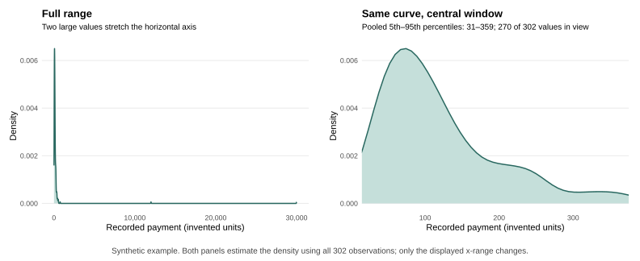

# Develop a research figure

The filenames, variables, and numerical examples below are invented adaptations of research workflow problems. They contain no research data.

**The job:** make one comparison legible. In the archived figure feedback, three technically competent plots were rejected because they answered three different, poorly specified questions. The lesson was to settle the comparison before asking for chart types.

## Specify what the reader should learn

Suppose the data contain positive recorded payments by request type. You want to compare the typical amounts and the spread, and a small number of very large payments stretch the range.

Give the agent the same question for every candidate:

```text
I want a reader to compare the distribution of positive recorded payments
across request types. Use the payment definition and sample from the report.
This is for a paper figure, not a presentation slide.

Inspect group sizes, missing amounts, zeros, and the distribution of
positive amounts. Then build three candidate figures from the same sample:
A. Median and interquartile range by request type.
B. Small-multiple distributions with common axes.
C. A design you think communicates this comparison better, or a useful
   variation if an unusual chart would add nothing.

Keep definitions and group order consistent. Show the actual rendered
candidates together, with one strength and one limitation for each.
Save the scripts as well as the figures.
```

The point is to compare the plots, not three verbal descriptions of plots. Candidate A makes the typical amount easy to compare but hides distribution shape. Candidate B can reveal multiple peaks and long tails, but needs more room. A third candidate earns its place by improving the same comparison.

If there are too few observations in a group to support a smooth distribution, ask for individual points or a simpler summary. The chart choice should respond to the data the agent actually inspected.

## Give a revision that changes a specific feature

A real feedback entry concerned a long-tailed distribution whose extremes compressed the main mass of observations—even after using a log scale. “Make it clearer” leaves too many possible repairs. A useful instruction names the region you want to see and how the omitted range should be disclosed:

```text
Keep the small multiples, but make the central distribution readable.
Use a common displayed range from the pooled 5th to 95th percentile of
positive payments. Keep the full-range version as a companion figure.

Report the bounds, the full eligible N, and the number inside the displayed
range for each group. State whether observations outside the window still
contribute to the distribution estimate. Do not silently recompute a
conditional distribution and label it as the full distribution.

Use the same axis limits across panels. Add a short note explaining the
window. Recompute any median or percentage claimed in the title against
the explicitly stated sample.
```

For example, a note might say: “Display limited to the pooled 5th–95th payment percentiles; panel counts give observations in view. Full-range distributions appear in the appendix.” The pooled bounds will not generally retain 90% of **each** group, so the group counts matter.

This is a display decision, not permission to trim the analysis sample or winsorize the data. In ggplot2, the distinction can be one line: `coord_cartesian(xlim = bounds)` zooms the view, while setting scale limits can remove observations before a statistical layer is calculated. The [official example](https://ggplot2.tidyverse.org/reference/coord_cartesian.html) shows the difference.

For an existing ggplot called `p_full`, built from the same positive-payment sample in `plot_data`, the change would look like:

```r
bounds <- quantile(plot_data$amount, c(0.05, 0.95), na.rm = TRUE)
p_central <- p_full + coord_cartesian(xlim = unname(bounds))
```

Here is that change on synthetic data. Both panels use the same density estimate; the right panel changes only the displayed range.



[Example R script](../assets/data-analysis/payment-window-example.R) — generates the fictional data, draws both panels, and checks that the density estimates are unchanged. The small example uses one group to isolate the display change; apply the same pooled bounds to every panel of the grouped figure.

The agent still needs to add the counts and caption, render both versions, and check whether the display is useful. If it has filtered the plotting data first, adding `coord_cartesian()` afterward does not restore the omitted observations.

Other revisions may be smaller. Another archived figure was unclear about whether its bars were stacked or overlaid. A direct note resolved that ambiguity; splitting it into panels made it harder to read. A separate figure repeated an obvious relationship already shown in a nearby table and was removed. Sometimes the useful revision is a label or a deletion.

## Inspect the final export and keep the reusable part

Ask the agent to open the saved figure at its intended size. It should check whether labels collide, annotations sit on top of data, and the caption still describes the current population. A title inherited from an earlier version can be wrong even when every plotted point is correct.

```text
Inspect the saved figure at the size it will occupy in the paper. List
what is visible: title, axes, units, group labels, sample note, and any
annotation. Check each numerical claim against the plotted data.

Fix clipping and collisions in the plotting code, export again, and inspect
the new file. Return the final figure, its script, and the conventional
alternative. Save useful style choices in the project's plotting theme;
keep this figure's sample restrictions in its own code.
```

For line and text charts, a PDF fits a LaTeX report and SVG fits a web report. Keep the code that regenerates the figure. A later change in the sample should update the points, labels, counts, and claim in the title together.

See the other [data-analysis walkthroughs](data-analysis.md).
